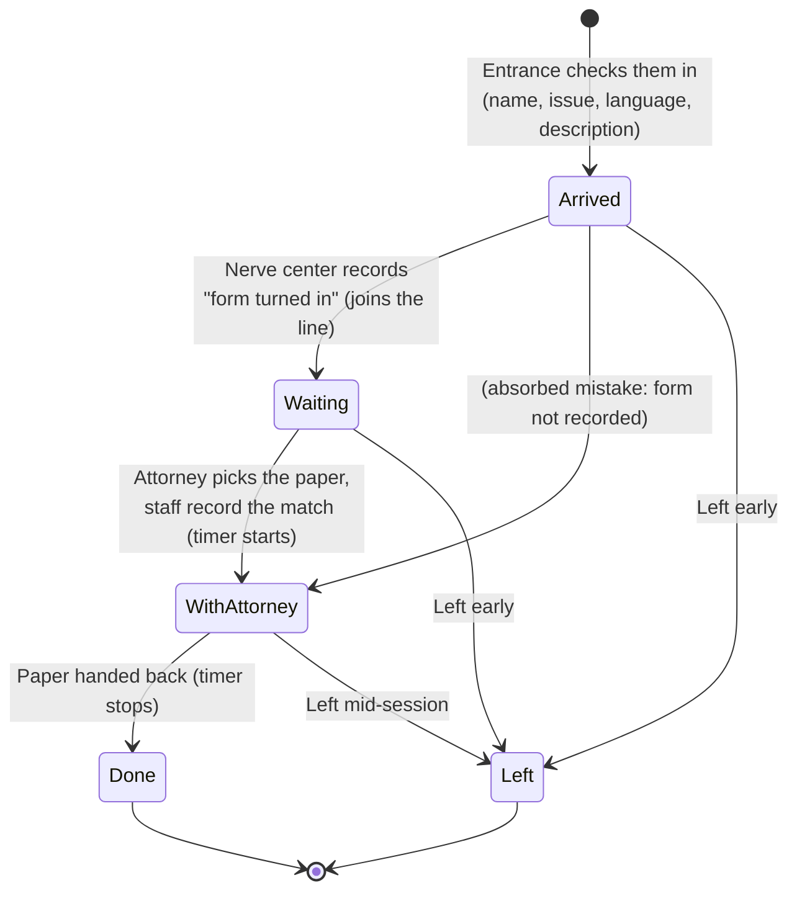
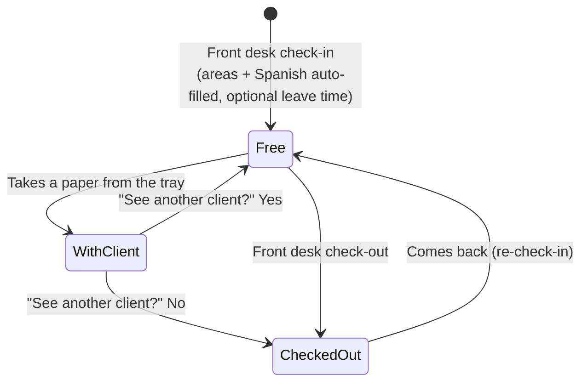

# VCLA Clinic Night: Live Queue Dashboard

A real-time dashboard that replaces the spreadsheet VCLA uses on legal clinic nights. It tracks every client from the front door to the attorney's table and every volunteer attorney from check-in to check-out. Staff can see, at any moment, **how many clients and attorneys each practice area has**, and nobody gets forgotten in the waiting room.

> **Status: working demo (Phase 1).** The key screens and logic are built and connected. Data lives in the browser for now (see [Architecture](#architecture)). Practice areas and the attorney list are **placeholders** until VCLA sends the real ones.

**Built for:** VCLA (clinic contact) · **Built by:** the CPVC team · **Stack:** Next.js 16 (App Router), React 19, TypeScript, Tailwind CSS v4, Vitest

---

## Contents

1. [Quick start](#quick-start)
2. [What we heard: design principles](#what-we-heard-design-principles)
3. [How a clinic night flows](#how-a-clinic-night-flows)
4. [Stations and who uses them](#stations-and-who-uses-them)
5. [Pages](#pages)
6. [Forms (guided flows)](#forms-guided-flows)
7. [The live dashboard: rules](#the-live-dashboard-rules)
8. [QA/QC: nobody unaccounted for](#qaqc-nobody-unaccounted-for)
9. [Data model](#data-model)
10. [Architecture](#architecture)
11. [Privacy and security](#privacy-and-security)
12. [Roadmap](#roadmap)
13. [Open questions for VCLA](#open-questions-for-vcla)
14. [Demo script for the next meeting](#demo-script-for-the-next-meeting)
15. [Project structure](#project-structure)

---

## Quick start

```bash
npm install
npm run dev        # http://localhost:3000
npm test           # queue, wait-time and QA rules
npm run lint
npm run build
```

On the home screen, choose **Load sample night**. This loads an evening already in progress: about 30 made-up clients, 9 attorneys, one overloaded line, one practice area with no attorney, and a few people the QA checks will flag. To see the stations update each other live, open **Entrance**, **Nerve Center** and **Dashboard** in separate tabs or windows.

---

## What we heard: design principles

These come directly from the 2026-10-23 kickoff. Every feature should trace back to one of them.

| # | Principle | What it means in the app |
|---|-----------|--------------------------|
| 1 | **The real-time queue is the product.** Reports matter, but the value is knowing *right now* how many clients and attorneys each practice area has. | The dashboard is the landing point for staff. Every action updates it immediately. |
| 2 | **Attorneys choose their clients.** The app suggests, staff record, nobody auto-assigns. ("The attorneys are the boss; they're volunteering.") | The match flow shows who is *next in line* but lets staff pick any paper the attorney took. It warns about skipping people but doesn't block it. |
| 3 | **Guided, "idiot-proof" screens.** The spreadsheet's logic was fine. Free-typing into cells broke it. | No grid editing. Every action is a short "What are you doing?" wizard with big buttons, a confirmation step and **Undo**. Invalid actions are refused with a plain-language reason. |
| 4 | **Find clients by description, not by name.** Names aren't called out in the room. | The description ("red sweater, Dodgers cap") is required, shown first in lists, and searchable. Shared screens show "Joe S.", never full names. |
| 5 | **Blatant green / yellow / red per practice area,** visible to the front desk, mobile responsive. | Full-width colored rows on the dashboard, and colored tiles at the top of the Entrance and Front Desk screens. Red pulses. Each color has a text label so it never depends on color alone. |
| 6 | **QA/QC: flag anyone unaccounted for.** ("A client once waited two hours and was never called.") | Live warnings, a head-count check, and an end-of-night Close Out that won't finish until everyone is resolved. |
| 7 | **History matters:** per clinic and yearly ("how many attorneys volunteered in 2026"). | The data is an append-only event log, so nothing writes over itself. Closed nights are saved to Reports. |
| 8 | **Eligibility is screened at the door.** | The app stores **nothing** about eligibility. People who don't qualify never enter the system. |
| 9 | **Function before branding. No AI features.** | Plain, high-contrast UI. The logo slot is ready for VCLA's designer. |
| 10 | **Clients never see the dashboard.** | Station screens are staff-only (login in Phase 2). A client-facing intake form, if built, is a separate locked-down page. |

**Scale to design for:** 30–40 clients a night, 12 practice areas, about 100 attorneys on the volunteer list, 2–4 staff devices open at once.

---

## How a clinic night flows

### Client states



* **Arrived ("on deck"):** checked in at the entrance and filling out the intake form.
* **Waiting:** the form has been reviewed and the paper is in the practice-area tray. **The line order starts here** (first come, first served within a practice area, by when the paperwork was turned in).
* **With attorney:** an attorney took the paper. The session timer is running.
* **Done** or **Left:** the only two ways out. Close Out requires every client to end in one of them.

### Attorney states



---

## Stations and who uses them

| Station | Who | Device | Main job |
|---------|-----|--------|----------|
| **Entrance** | Door volunteer | Phone or tablet | Check clients in and hand them a form. Sees the traffic lights so they know whether to let someone in for a given issue. |
| **Nerve Center** | Orchestrator / staff | Laptop | Record forms turned in, attorney-to-client matches, finished sessions and clients leaving. Watches QA warnings. |
| **Front Desk** | Front desk staff | Laptop or tablet | Check attorneys in and out. Mark clients who leave. Sees the traffic lights ("we can't take another housing case tonight"). |
| **Dashboard** | Nerve center + front desk (never clients) | Any screen, including a wall monitor | The live picture. |
| **Close Out** | Orchestrator | Laptop | End of night: account for everyone, then save the night. |
| **Reports** | VCLA leadership | Laptop | Per-clinic and yearly history, CSV export. |

---

## Pages

✅ = in the demo now · 🔜 = planned (see [Roadmap](#roadmap))

| Route | Page | Status | Purpose and key elements |
|-------|------|--------|--------------------------|
| `/` | **Home / station picker** | ✅ | Start tonight's clinic (set closing time), or load the sample night. Big links to each station. Demo reset tools. |
| `/dashboard` | **Live Dashboard** | ✅ | Red/yellow/green tally. Head-count tiles (in waiting room, with attorneys, attorneys free/busy, done, left). **One row per practice area:** attorneys here vs. clients in line, estimated wait for a new arrival, next in line (by description), and a staff **Close for tonight** override. Side panels: head-count check sentence, *Needs attention* alerts, and the **waiting room** (longest wait first, with an estimated "seen ~8:05" time). Auto-refreshes every 10 s. Option to hide empty areas. |
| `/entrance` | **Entrance: client check-in** | ✅ | Traffic-light tiles on top. A 4-step wizard (see [Forms](#forms-guided-flows)). The confirmation screen gives a script for what to tell the client ("#3 in the Housing line, 1 attorney: expect about 1h 15m"). Side list: *Walking in now* (on deck). |
| `/nerve-center` | **Nerve Center** | ✅ | "What are you doing?" menu with five guided flows: form turned in · attorney took a client · attorney finished · client leaving · fix a mistake. Side panels: *Needs attention* and *With attorneys now* (live timers, red over 60 min). |
| `/front-desk` | **Front Desk** | ✅ | Traffic-light tiles. Guided flows: attorney arriving · attorney leaving · client leaving. Side list: *Attorneys here* (areas, Spanish, time here, planned leave time, clients seen). |
| `/close-out` | **Close Out** | ✅ | Lists every client not yet Done/Left and every attorney still checked in, each with one-tap fixes. **Close the clinic** stays disabled until the list is empty, then saves the night to Reports. |
| `/reports` | **Reports** | ✅ (basic) | Tonight in progress. Year in review: nights, clients seen, left early, **unique attorneys who volunteered**, average wait, clients by practice area, attorney list. Table of past nights. CSV export. |
| `/reports/[clinicId]` | Per-clinic report | 🔜 | Full detail for one night: timeline, per-attorney counts, per-area waits, who left and when. |
| `/admin/attorneys` | Volunteer list | 🔜 | Add, edit and deactivate attorneys (name, practice areas, Spanish, contact). Import from VCLA's existing list (CSV). |
| `/admin/practice-areas` | Practice areas | 🔜 | Manage the 12 areas (name, short label, order, active). |
| `/admin/settings` | Settings | 🔜 | Thresholds (green/yellow limits, QA timers, default session length), default closing time, languages. |
| `/admin/audit` | Activity log | 🔜 | Every action with time, station and user, including undone ones. |
| `/login` | Staff sign-in | 🔜 | Station logins. No public access to any staff page. |
| `/intake` | Client intake form | 🔜 (optional) | A private, mobile replacement for the paper/Google form that clients fill out in the waiting room. Submitting it could mark them **Waiting** automatically. Needs VCLA's paper form first, plus a privacy review (see [Open questions](#open-questions-for-vcla)). |

---

## Forms (guided flows)

Every flow follows the same pattern, which comes straight from VCLA's description: *"What are you doing?" → "I'm saying they turned in their form" → type the first name → "Are you talking about Joe Smith?" → yes → click the box.*

* One question per step, with big tap targets and a step counter.
* Search by **first name or description** wherever you pick a client.
* A **confirmation step** that restates the action in plain words.
* After saving, a toast with **Undo** (8 seconds). Older mistakes are fixed under *Fix a mistake*.
* **Guardrails, not dead ends:** impossible actions are refused with a reason. Unusual but legitimate actions (skipping the line, an attorney outside their listed area) show a warning and are allowed.

### 1. Client check-in (Entrance)

| Step | Field | Input | Rules |
|------|-------|-------|-------|
| 1 | Legal issue | 12 large buttons. Each shows its live light and wait. | Required. Picking a **red** area shows a warning to check with the nerve center first. |
| 2 | First name, Last name | Text | Both required (an initial is fine for last name). **Duplicate warning** if the same first name and last initial is already checked in tonight. |
| 2 | Language | Buttons: English, Spanish, Mandarin, Cantonese, Vietnamese, Korean, Tagalog, Armenian, Other | Default English. Drives translator warnings. |
| 3 | What they look like | Text, plus quick-add chips ("red sweater", "baseball cap", …) | Required. This is how staff find people. |
| 4 | Review | Summary with *Change* links and the expected line position and wait | Submit → client is **Arrived**. Then: "Hand them an intake form. Tell them: …" |

*Not collected:* eligibility, address, phone, case details. (The paper intake form covers case details.)

### 2. Form turned in (Nerve Center)

1. **Whose form is it?** Pick from clients **on deck**.
2. **Confirm.** Shows the description, an option to correct the practice area if the form says something different, and the line position. Submit → **Waiting**: "Put the paper in the HOUSING tray. They're #3."

### 3. Attorney took a client's paper (Nerve Center)

1. **Which attorney?** Only checked-in attorneys. Anyone already with a client is disabled, with the reason shown.
2. **Whose paper?** The waiting lines for *that attorney's* practice areas, longest wait first, with a **Next in line** badge. *Show everyone* covers off-area or on-deck picks.
3. **Confirm**, with soft warnings: *skipping N people who've waited longer* · *no form recorded yet (we'll mark it now)* · *outside their listed areas* · *client speaks Spanish, attorney doesn't: line up a translator.* Submit → **With attorney** and the timer starts.

### 4. Attorney finished (Nerve Center)

1. **Who handed a paper back?** Running sessions with timers.
2. **Does {attorney} want to see another client?** *Yes* → back in the pool. *No* → checked out. The client becomes **Done**.

### 5. Client leaving (Nerve Center or Front Desk)

1. **Who is leaving?** Any client still in the building.
2. **Confirm.** If they were with an attorney, that session ends and the attorney returns to the pool. The client becomes **Left**.

### 6. Fix a mistake (Nerve Center)

* **Undo the last action** (shows what it was, when and from which station).
* **Change a client's details:** practice area, description, language.
* **Recent activity** list (undone actions shown struck through).

### 7. Attorney check-in (Front Desk)

1. **Who is arriving?** Search the volunteer list. People already here are disabled. *Not on the list?* lets you add a walk-in volunteer.
2. **Details:** practice areas (**auto-filled** from the list and editable for tonight), **Speaks Spanish?** (auto-filled), and **When do they need to leave?** ("Didn't say" or the next few half-hour times). Submit → **Free**.

### 8. Attorney check-out (Front Desk)

Pick a checked-in attorney (anyone still with a client is disabled until the session is finished) → confirm, showing how many clients they saw tonight.

### 9. Start / close the clinic

* **Start** (Home): closing time (default 8:30 PM).
* **Close** (Close Out): available only when every client is Done/Left and every attorney is checked out. It saves a summary to Reports and resets the stations.

---

## The live dashboard: rules

### Estimated wait

For each practice area, the app simulates the tray. Every attorney here who covers that area becomes free either *now* or when their current session should end. Each one then takes the next paper in line order. No one starts a new session less than half a session before closing time or before the attorney's stated leave time. People **on deck** count too, because they'll be in line in a few minutes.

The default session length is 30 minutes. After 3 sessions finish, the app uses tonight's real average.

> VCLA's own example: one attorney is 15 minutes into a session and two people are already in line. The third person would wait about **1 h 15 m**. The app gets exactly this answer, and a unit test checks it (`src/lib/__tests__/engine.test.ts`).

### Traffic lights

| Light | Meaning for the front desk | Rule (defaults in `src/lib/config.ts`) |
|-------|---------------------------|-----------------------------------------|
| 🟢 **GREEN** | Come on in | A new arrival would wait **≤ 30 min** |
| 🟡 **YELLOW** | Come in, but expect a wait | Wait **31–90 min** |
| 🔴 **RED** | Stop letting people in for this issue tonight | Wait **> 90 min**, **or** they likely won't be seen before close, **or** clients are in line with no attorney for that area, **or** staff tapped **Close for tonight** |
| ⚪ **GRAY** | No attorney yet | Nobody in line and no attorney for that area checked in (common early in the evening, because clients arrive before attorneys) |

**Known simplification:** an attorney who covers two areas counts fully toward both, so capacity is slightly optimistic in shared areas. To revisit with real data.

---

## QA/QC: nobody unaccounted for

| Check | Severity | Default trigger |
|-------|----------|-----------------|
| Client waiting too long | ⚠️ warning / ⛔ critical | Waiting ≥ 60 min / ≥ 90 min |
| Checked in but no form recorded | ⚠️ | On deck ≥ 30 min ("Still here?") |
| Session running long | ℹ️ | With attorney ≥ 60 min ("Was the paper handed back?") |
| Attorney past their stated leave time | ⚠️ | Still marked free after their leave time |
| Clients in line, no attorney for that area | ⛔ | Any |
| Spanish-speaking client, no Spanish-speaking attorney in that area | ℹ️ | Any ("Line up a translator") |
| Approaching or past closing with people still in the building | ⚠️ / ⛔ | ≤ 30 min to close / past close |
| **Head count** | always shown | "There should be **10** people in the waiting room (7 waiting, 3 filling out forms) and **4** with attorneys." Also: checked in = here + done + left. |
| **Close Out gate** | blocking | The clinic can't close while anyone is unresolved |

Validation also refuses impossible states, such as booking an attorney who is already with someone, checking out an attorney mid-session, or moving a client who is already done.

---

## Data model

The app is **event-sourced**. Every confirmed action appends one immutable event. Current state is always rebuilt from the event log. This fixes the spreadsheet's core problem (data writing over itself), gives a full audit trail, makes Undo safe, and makes yearly reports straightforward.

**Events** (`src/lib/types.ts`): `client_checked_in`, `form_turned_in`, `session_started`, `session_ended`, `client_left`, `client_updated`, `attorney_checked_in`, `attorney_checked_out`, `area_override`. Each one carries `id`, `at` (timestamp), `station`, and `undone?`.

**Derived state:**

| Entity | Key fields |
|--------|-----------|
| `Clinic` (one per night) | `date`, `openedAt`, `closesAt` |
| `Client` (per night) | first/last name, `practiceAreaId`, `language`, `description`, `status`, `arrivedAt`, `waitingAt` (queue order), `sessionStartedAt`, `finishedAt` / `leftAt`, `attorneyId` |
| `AttorneyOnSite` (per night) | roster id, name, tonight's `practiceAreaIds`, `spanish`, `leaveBy?`, `status`, `clientsSeen` |
| `Session` | `clientId`, `attorneyId`, `startedAt`, `endedAt`, `outcome` (done / client_left) |
| `RosterAttorney` (standing list) | name, default practice areas, Spanish |
| `NightSummary` (reports) | counts, unique attorneys, average wait/session, per-area breakdown |

**Production tables (Phase 2, proposed):** `clinics`, `events` (the source of truth), `attorneys` (roster), `practice_areas`, `settings`, `staff_users`. Read models such as tonight's state and reports can be rebuilt from `events` at any time.

---

## Architecture

### Now (demo)

```
Browser tab ── useClinic() ──► store.ts ──► localStorage (event log + history)
                                   ▲
           other tabs ◄── BroadcastChannel / storage events (instant sync)
```

* All logic is in `src/lib/engine.ts`: pure functions with time passed in, unit-tested.
* `src/lib/store.ts` is the only file that knows where data lives. Components use only `useClinic()` and `dispatch()`.
* **Limitation:** data stays in one browser. Tabs and windows sync live, but **separate devices don't**. Fine for demos, not for a real clinic night.

### Phase 2 (production): recommended

* **Database and real-time:** hosted Postgres with real-time subscriptions. **Supabase** is the recommended default for a student team: Postgres, real-time, auth and row-level security in one free-tier service. Alternative: Neon/Postgres with Next.js Route Handlers and Server-Sent Events.
* **Swap plan:** replace `store.ts` with a version that inserts events into the `events` table and subscribes to new rows. `engine.ts` and every screen stay the same. Validate on the server too, so two staff can't book the same attorney at once.
* **Hosting:** Vercel (pairs with Next.js), giving a live URL for the every-other-week demos.
* **Resilience:** tolerate flaky church or community-center Wi-Fi. Queue events locally and replay them on reconnect, and show a clear "offline" banner.

---

## Privacy and security

* **Collect the minimum:** first and last name, practice area, language and a clothing description. No eligibility data, no contact info, no case facts in the live app.
* **Names stay off shared screens.** Dashboards show "Joe S." plus a description. Full names appear only inside pickers when staff are actively choosing someone.
* **Staff-only access** (Phase 2): every station behind login, with no public routes except an optional intake form.
* **Retention:** decide with VCLA how long client names are kept. Proposal: strip names from closed nights after N days and keep anonymous counts for reports.
* **No real client data in this repo, demos or tests.** All sample names are invented.

---

## Roadmap

**Phase 1: working demo** ✅ *(this commit)*
- [x] Station screens: Entrance, Nerve Center, Front Desk, Dashboard, Close Out, Reports
- [x] Guided flows with confirmation, validation, Undo and *Fix a mistake*
- [x] Traffic lights with wait-time simulation and staff override
- [x] QA/QC alerts, head-count check, Close Out gate
- [x] Event-sourced data with cross-tab live sync and a sample night
- [x] Mobile-responsive layouts; unit tests for core rules

**Phase 2: real clinic night (next 2–4 weeks)**
- [ ] Load the **real 12 practice areas** and **attorney list** from VCLA
- [ ] Hosted database and real-time sync across devices (Supabase); deploy to a live URL
- [ ] Staff login; server-side validation
- [ ] Admin screens: volunteer list, practice areas, settings
- [ ] Offline/reconnect handling
- [ ] Dry run with VCLA staff using fake clients, then fix what confuses people

**Phase 3: history and polish**
- [ ] Per-clinic report page; yearly report export (PDF/CSV) in VCLA's preferred format
- [ ] Import historical data from the old spreadsheet (cleaned)
- [ ] VCLA branding and logo (from their designer)
- [ ] Wall-monitor / TV mode for the dashboard
- [ ] Optional: digital client intake form at `/intake`

---

## Open questions for VCLA

1. **Practice areas:** the official list of 12, with the short labels staff use out loud.
2. **Attorney list:** the ~100 names with practice areas, Spanish, and any other languages. Who maintains it?
3. **Old spreadsheet and paper intake form** (client data removed): to check that we capture every field they report on.
4. **Thresholds:** are 30/90 minutes the right green/yellow/red limits? Should red trigger at a set number of people instead?
5. **Closing time:** a fixed time every night? When does "last call" for new clients happen?
6. **Other languages:** besides Spanish, which languages matter for matching and translators?
7. **Who uses which device?** How many laptops and phones, and is there reliable Wi-Fi at the venue?
8. **Reports:** which numbers do funders and the board ask for (clients served, attorney hours, by area, by language, left without being seen)?
9. **Retention:** how long may client names be kept?
10. **Expected attorneys:** do attorneys sign up ahead of time? If so, the app could predict capacity before they arrive and turn early-evening GRAY into a real forecast.
11. **Moving someone ahead in line:** should this be an explicit, logged "priority" action (e.g. elderly or disabled clients)?

---

## Demo script for the next meeting

1. **Home** → *Load sample night*. Open the **Dashboard** on the projector.
2. Point out **Housing is RED** (one attorney, long line), **Benefits is RED** (a client but no attorney), and the **⛔ alert** for the client who has waited 1h 30m+, which is the "two hours and never called" scenario.
3. In another window, go to **Entrance** and check in a new client. The Dashboard updates instantly.
4. **Nerve Center** → *A client turned in their form* → *An attorney took a client's paper*. Show the **Next in line** suggestion and that the attorney can still choose anyone.
5. Tap **Undo** in the toast to show that mistakes are cheap.
6. **Front Desk** → check in an attorney for Benefits and watch that row change from red.
7. **Close Out**: show that the night can't close while anyone is unaccounted for. Then **Reports**: yearly attorney count.

---

## Project structure

```
src/
  app/                      # Routes (thin server pages that render the views)
    page.tsx                # Home / station picker
    dashboard/ entrance/ nerve-center/ front-desk/ close-out/ reports/
    layout.tsx, globals.css
  components/
    views/                  # One component per station screen
    TrafficBoard.tsx        # Dashboard rows + compact tiles
    AlertsPanel.tsx         # QA/QC warnings
    Pickers.tsx             # Client / attorney / roster search pickers
    ClinicGate.tsx          # Loading + "no clinic open" guard
    AppHeader.tsx, Toaster.tsx, ui.tsx
  lib/
    types.ts                # Domain + event types
    config.ts               # Practice areas (placeholder), languages, thresholds
    roster.ts               # Sample volunteer list (made-up names)
    engine.ts               # Replay, validation, wait simulation, lights, QA, reports
    store.ts                # Demo persistence + live sync (swap for the backend)
    sample.ts               # Sample clinic night generator
    actions.ts, toast.ts, useNow.ts, ids.ts
    __tests__/engine.test.ts
```

Note: `AGENTS.md` is generated by Next.js 16 and points coding assistants to the bundled docs in `node_modules/next/dist/docs/`. This version of Next.js differs from older tutorials, so check those docs first.
